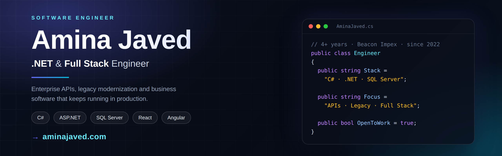

  

<h1 align="center">Hi, I'm Amina Javed</h1>

  <b>Software Engineer · .NET &amp; Full Stack · in production systems since 2022</b> 
  I design, build and modernize the business software companies run on every day.

  &nbsp;
  &nbsp;
  &nbsp;
  &nbsp;
  &nbsp;
  

  

---

## About me

I am a **.NET & Full Stack Software Engineer** at **Beacon Impex (Pvt) Ltd** in Faisalabad, Pakistan, working professionally since **August 2022**. I specialize in secure backend systems and APIs built with **C#, ASP.NET Core, ASP.NET Web API, Entity Framework, ADO.NET and SQL Server**, for business software used every day in ticketing and field service, vehicle tracking and invoicing, transport, warehouse operations, access control, accounting and IoT.

Highlights of my professional work include serving as the **primary backend developer of a .NET 8 ticketing and field-service platform**, developing a **customer and partner booking API with JazzCash online payments**, integrating **tax-invoice submission to the Punjab Revenue Authority (PRA)**, and implementing **JWT authentication with refresh tokens and server-side session revocation**. I also work confidently inside legacy **WinForms, WCF, SOAP and Silverlight** systems, fixing long-standing defects and moving them toward REST and ASP.NET Core without breaking production.

Beyond .NET, I build full-stack and frontend projects with **React, Angular, Blazor, Node.js and Django**, including multilingual and right-to-left websites, and I design, build and launch websites for clients from design to deployment and SEO. I hold a **BS in Computer Science from FAST NUCES Faisalabad** and I am open to full-time, remote and contract work.

---

## What I do

| Area | Skills & experience |
| :-- | :-- |
| ⚙️ **Backend & APIs** | C#, .NET Framework, .NET 8, ASP.NET Core, ASP.NET Web API, RESTful APIs, WCF, SOAP services, JWT (refresh tokens, session revocation), role- and partner-level permissions, N-tier architecture, Dependency Injection, Swagger / OpenAPI, Serilog, MSTest |
| 🗄️ **Data** | SQL Server, T-SQL, stored procedures, Entity Framework 6, EF Core (Code First & Database First / EDMX), ADO.NET, LINQ, MongoDB, MySQL, SQLite |
| 🏚️ **Legacy modernization** | .NET Framework, Silverlight, WCF and SOAP systems maintained, debugged and moved toward REST and ASP.NET Core without breaking production |
| 🖥️ **Desktop & business tools** | Windows Forms apps for production planning, Excel import and validation (EPPlus), product labels and QuickBooks IIF accounting files |
| 📊 **Reporting** | SQL Server Reporting Services (SSRS), RDLC, Crystal Reports, PDF / Word / Excel exports |
| 🔌 **Integrations** | JazzCash payments, PRA tax-invoice submission, WhatsApp Business API, Meta Graph API, Firebase push notifications, MQTT (MQTTnet) for IoT devices, SMTP / MailKit, QR codes, Google Places API, OpenStreetMap / Overpass API, Leaflet.js, Insightly CRM |
| 🌐 **Frontend** | React, React Router, Angular, Blazor WebAssembly, TypeScript, JavaScript, HTML5, CSS3, Tailwind CSS, Bootstrap, Vite, responsive single-page apps, multilingual and right-to-left sites |
| 🧩 **Other backends** | Node.js, Express.js, Python, Django, Django REST Framework |
| 🚀 **Delivery & DevOps** | Git, GitHub Actions, CI/CD, Docker, IIS, Cloudflare Pages, Render, production support, API documentation |
| 🔎 **SEO & web presence** | Technical and local SEO, JSON-LD structured data, sitemaps, mobile-first design, WhatsApp ordering and enquiry flows |

---

## Experience

### Software Engineer · Beacon Impex (Pvt) Ltd · *Aug 2022 – present*

Highlights:

- **Tracket** (ticketing & field service): primary backend developer of a .NET 8 N-tier ASP.NET Core API with EF Core: ticket workflows, technician assignment, JWT with refresh tokens and role-based access, Firebase push notifications and authenticated SSRS PDF reports.
- **Terminal Management System** (bus ticketing): designed and built the customer and partner Web API on top of the desktop system: seat-level booking validation, JazzCash online payments, database-backed JWT sessions and per-partner API permissions.
- **Tracko IS** (vehicle tracking & invoicing): core developer across its WinForms client, WCF service and Web API: SIM lifecycle management, invoicing workflows, PRA tax-invoice integration and an inventory IN/OUT API with IMEI and QR scanning.
- **Zephyr** (IoT HVAC platform): backend and MQTT device communication for remote monitoring and control of air conditioners, with temperature and scheduling policies checked before every command.
- **Warehouse Management System**: co-developed the backend for inbound inspection, routing, an operator job engine and outbound dispatch.
- **WIP Analysis Tool**: primary developer of a production-planning application with a Strategy-pattern calculation engine and validated Excel imports.
- **TruckDestino**, **MMS**, **RouteTrack**, **GPMS**, **QuickBooks IIF Generator** and **Denim Labels Utility**: fleet-platform modernization, meeting-room and QR gate access, transport routes (in progress), garment production, accounting files and label generation.

All Beacon Impex systems

 

| System | Domain | Stack |
| :-- | :-- | :-- |
| Tracket | Ticketing & field service | ASP.NET Core (.NET 8), EF Core, SQL Server, JWT, Firebase, SSRS |
| Tracko IS | Vehicle tracking & invoicing | .NET Framework, Web API, WCF, ADO.NET, WinForms |
| Terminal Management System | Bus ticketing | ASP.NET Web API, WinForms, Entity Framework, JWT, JazzCash |
| Zephyr | IoT / HVAC | ASP.NET Web API, MQTTnet, Entity Framework, JWT |
| Warehouse Management System | Warehouse operations | ASP.NET Web API, EF Code First, EPPlus |
| WIP Analysis Tool | Production planning | WinForms, Entity Framework 6, SQL Server, EPPlus |
| RouteTrack *(in progress)* | Transport routes & vehicles | ASP.NET Web API, EF Code First, JWT, MailKit |
| TruckDestino | Fleet management | Silverlight, SOAP, REST APIs, SQL Server |
| MMS | Meeting rooms & gate access | Web API, EF Database First, WhatsApp API, QR codes |
| GPMS | Garment production & packing | WCF, EF Database First, MSTest |
| QuickBooks IIF Generator | Accounting data | WinForms, ADO.NET, EPPlus |
| Denim Labels Utility | Product labels | WinForms, EPPlus, RDLC, Crystal Reports |

These are proprietary employer systems, so there are no public demos.

### Freelance Developer · *Oct 2025 – present*

Client work, from design to deployment and SEO:

| Client | What I built | Live |
| :-- | :-- | :-- |
| **Uni Advisers** | React and Vite site with country guides, a university catalogue and enquiries sent to the client's CRM | [uniadvisers.co.uk](https://uniadvisers.co.uk) |
| **Ultimate Educational Solutions** | Website for a UK & Pakistan study-abroad consultancy | [us-pakistan.co.uk](https://us-pakistan.co.uk) |
| **Savory Dumplings** | Mobile-first restaurant site with WhatsApp ordering, Google Maps and local SEO | [savorydumplings.com](https://savorydumplings.com) |
| **Ipswich Retail** | Django e-commerce store, containerized with Docker and deployed on Render | [Live store](https://amina-devops-poc.onrender.com) |

> 🔒 **My code is private.** Live demos, descriptions and full case studies for every project are on **[aminajaved.com](https://aminajaved.com)**.

---

## Education & certifications

🎓 **BS Computer Science**, FAST NUCES Faisalabad (2018 – 2022)  
🏅 **Dean's List of Honors**, Fall 2018

<table>
  <tr>
    <td align="center" width="140" height="44"></td>
    <td valign="middle"><b><a href="https://coursera.org/verify/professional-cert/2CPTH4F23Y8M">Microsoft Full-Stack Developer</a></b></td>
  </tr>
  <tr>
    <td align="center" width="140" height="44"></td>
    <td valign="middle"><b><a href="https://coursera.org/verify/professional-cert/CES0M4XG70JX">IBM Full Stack Software Developer</a></b></td>
  </tr>
  <tr>
    <td align="center" width="140" height="44"></td>
    <td valign="middle"><b><a href="https://coursera.org/verify/professional-cert/T2O6HAMC5Z9J">IBM Full-Stack JavaScript Developer</a></b></td>
  </tr>
  <tr>
    <td align="center" width="140" height="44"></td>
    <td valign="middle"><b><a href="https://coursera.org/verify/specialization/GDS86I5P383R">Meta Full Stack Developer</a></b> · <a href="https://www.credly.com/badges/d1849ece-d110-47a6-b363-f4d55053de73">Credly badge</a></td>
  </tr>
</table>

🔗 Each certificate links to its Coursera verification page. All my badges are also on [Credly](https://www.credly.com/users/aminajaved1999/badges).

---

## Let's work together

I'm open to **full-time, remote and contract roles**, freelance projects, short-term fixes and long-term maintenance, especially in:

`.NET / C#` · `ASP.NET Core & Web API` · `Secure APIs & integrations` · `Legacy modernization` · `WinForms business tools` · `Full-stack web`

  <a href="https://aminajaved.com">Portfolio</a> ·
  <a href="https://linkedin.com/in/aminajaved1999">LinkedIn</a> ·
  <a href="https://www.credly.com/users/aminajaved1999/badges">Credly</a> ·
  <a href="https://www.upwork.com/freelancers/~01df798d061c070f10">Upwork</a> ·
  <a href="https://www.fiverr.com/aminajaved1999">Fiverr</a> ·
  <a href="https://arc.dev/@aminajaved">Arc</a> ·
  <a href="mailto:aminajaved1999@gmail.com">aminajaved1999@gmail.com</a>

